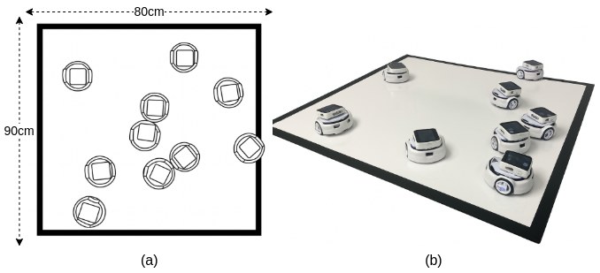

# Swarm Communication Platform (ESP32)

A platform for enabling communication within swarm robotics systems using ESP32 microcontrollers. This project leverages the ESP32's capabilities along with various components to create a decentralized communication system for swarm robots.



## Directory Structure

- **/src** - Source code for the platform
  - **/components** - External libraries and components
    - **/data_logging** - For writing data concurrently in SD card
    - **/env_config** - Set up Wi-Fi and environment variables
    - **/espnow_main** - Manage decentralised communication for swarm
    - **/genetic_algorithm** - Embedded evolution implementation (elitist)
    - **/global_vars** - Variables used for experimental runs (IVs)
    - **/gui_manager** - Manage M5 display
    - **/https** - Handle experimental data stream to S3
    - **/ota** - Over-the-air updates component
    - **/rtc_m5** - Synchronise experiments with real-time clock module
    - **/sd_card_manager** - Handle SD card operations  
    - **/axp192** - Power management IC driver
    - **/i2c_manager** - I2C communication manager for ESP32
    - **/m5core2_axp192** - M5Core2-specific AXP192 implementation
    - **/lvgl** - Light and Versatile Graphics Library (v7)
    - **/lvgl_esp32_drivers** - Drivers for LVGL on ESP32
    - **/arduino** - Arduino-ESP32 core
- **/ir_board** - IR communication board implementation (Swarm-B2) *NOT USED*
- **/3Pi_BrownianMotion** - Arduino code for Brownian Motion, includes I2C slave driver.
- **/data_analysis** - Experiment data and processing scripts used to build figures.
- **/diagrams** - `.drawio` raw files for building report diagrams
- **/report_dissertation** - LaTeX local copy of dissertation

## Key Features
- Decentralized communication protocol for swarm robotics (ESP-NOW)
- ESP32-based implementation for low-cost deployment
- Mesh networking capabilities
- Real-time data synchronization between swarm members
- Power management using AXP192
- GUI capabilities using LVGL

## Setup and Installation
1. Clone this repository with submodules:
   ```
   git clone --recursive https://github.com/your-username/robotics_dissertation.git
   ```
2. If already cloned without submodules, initialize and update them:
   ```
   git submodule update --init --recursive
   ```
3. Set up the ESP-IDF development environment (v5.1.4)
4. Open `src` directory:
   ```
   cd src/
   ```
5. Build and flash to your ESP32 device:
   ```
   idf.py build
   idf.py -p PORT flash
   ```

## Dependencies
### Hardware:
- ESP32 development boards (specifically tested with M5Stack Core2)
- Power management circuitry compatible with AXP192

### Software:
- ESP-IDF framework
- Arduino core for ESP32 (optional)
- LVGL (v7)

## Contributors
- Luis Yallico

## Acknowledgements
This project incorporates the following open-source components, with minor adaptations:

- **Swarm-B2 (IR Board)**: IR communication board
  - Repository: https://github.com/yallico/Swarm-B2
  - Used for: Implementing IR-based robot-to-robot communication
  - Contributor: Paul O'dowd

- **AXP192 Driver**: Power management for ESP32 projects
  - Repository: https://github.com/yallico/axp192
  - Used for: Managing power in the swarm communication platform
  - Contributor: Mika Tuupola

- **ESP I2C Manager**: I2C communication management
  - Repository: https://github.com/yallico/esp_ic2_manager
  - Used for: Facilitating I2C communication between AXP192 power supply and ESP32
  - Contributor: Mika Tuupola
